# User guide

See [Installation and operations](installation.md) for setup and server management.
The UI supports its existing English and German translations. Screenshots show
fictional demo data in the German UI; button labels can differ by locale.

## Sign in and roles

Registration normally requires an invitation. Open the invitation link, register
with the invited email address and choose a password of at least 12 characters.
If registration is refused, ask an administrator to check the invitation.

Administrators can enroll a second factor from Team using an authenticator app.
Store the recovery codes securely. If the installation requires administrative
TOTP, enroll before enforcement is enabled.

| Role      | Typical permissions                                              |
| --------- | ---------------------------------------------------------------- |
| Viewer    | Read records permitted by the organization's policies            |
| Editor    | Maintain master data and create, review and publish passports    |
| Admin     | Editor access plus team, connector and administrative operations |
| Authority | Controlled-data access permitted by the applicable role policy   |

Individual data elements may have additional read/write policies. Controlled
fields are available only to permitted authenticated roles. A field being hidden
can be an intended policy restriction.

## Navigation

The dashboard shows the current overview. Product passports lists passports and
status filters. Products, Facilities and Economic operators contain master data.
Dictionaries define the meaning and types of passport fields. Connectors and Team
provide administration. Cmd+K or Ctrl+K opens the command palette.

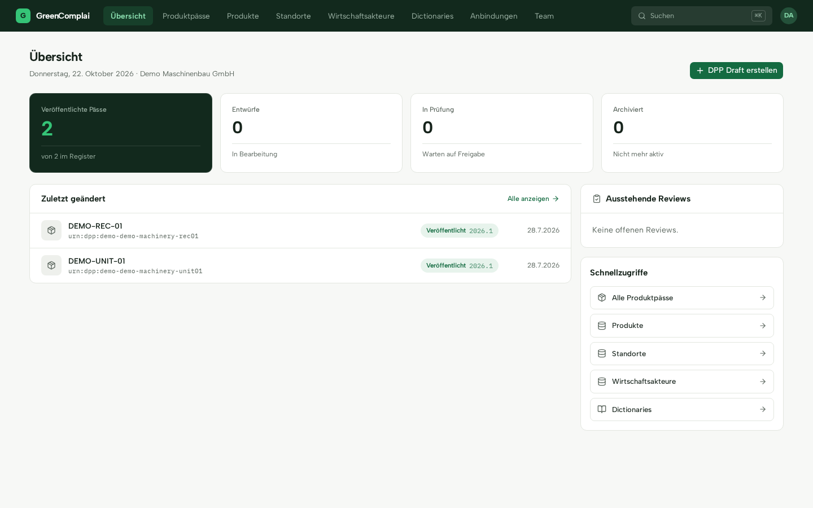

## Create and publish a passport

### Prepare master data

Create an economic operator for the responsible manufacturer or other business
role. Give it an identifier, company name, role and location. The fictional demo
uses `EO-DEMO_MACHINERY`. Reuse that operator across the appropriate products.

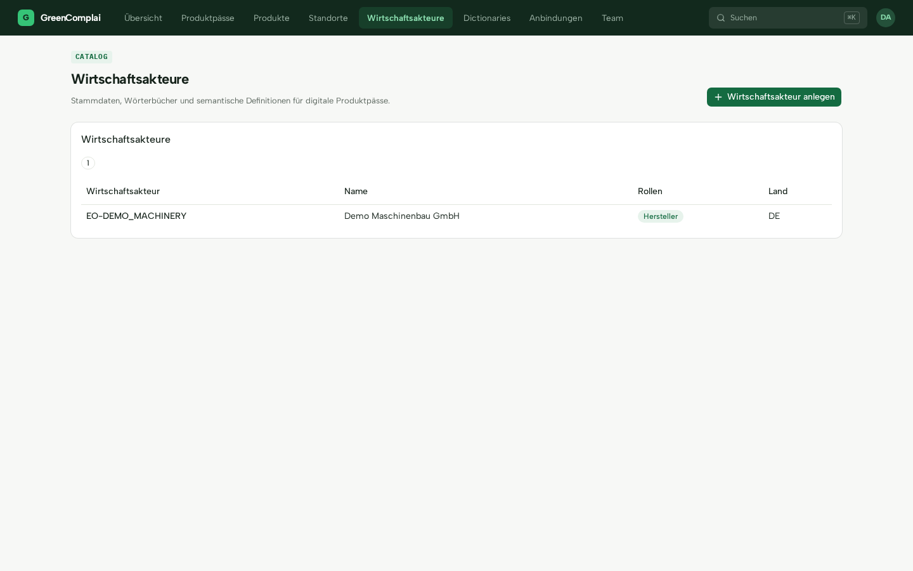

Create a facility when a site is relevant. Facilities have an identifier, name,
type and address, for example manufacturing, testing, storage or repair.

Create a dictionary with a title, namespace URI and version. A namespace identifies
the vocabulary, for example
`https://demo.dpp.local/dictionaries/demo-machinery/2026.1/`.

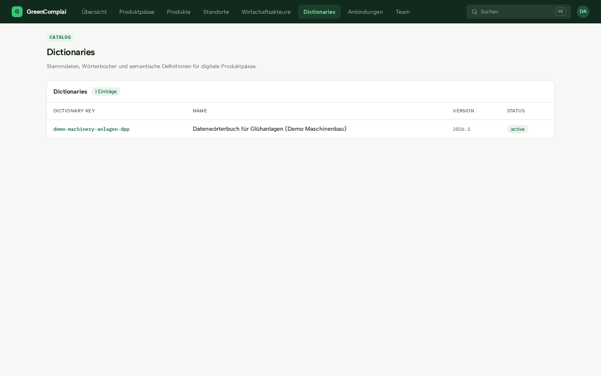

Add entries with a key, label, type and optional unit, allowed values and validation
rules. Review the draft and activate it before using it for published passports.
Existing passports bind to a specific dictionary version; use versioning when
the vocabulary changes.

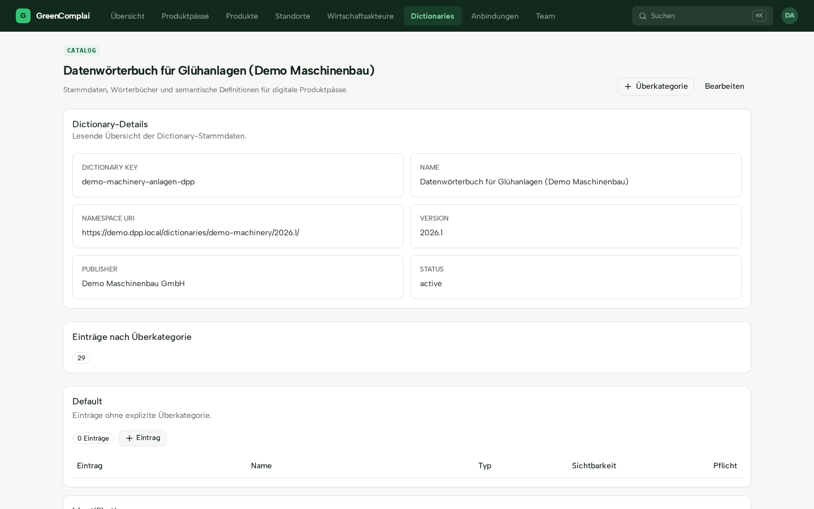

Create the product and maintain its identifiers, such as GTIN, serial number,
batch, model and article number. Save the identifier list after editing it.

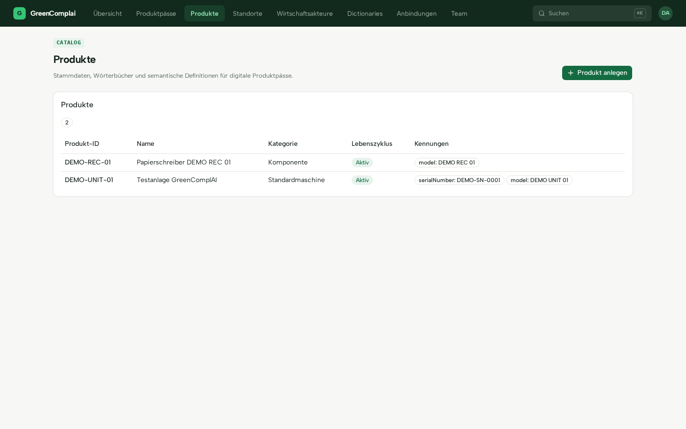
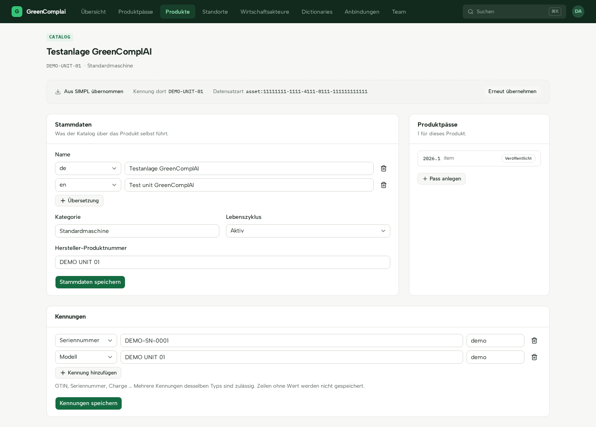

### Create a draft

Create a DPP draft and select the product, economic operator, dictionary version
and granularity:

| Granularity | Applies to                  |
| ----------- | --------------------------- |
| `model`     | A model and its instances   |
| `batch`     | A production batch          |
| `item`      | An individual physical item |

Fill the fields and choose their visibility. Public fields can appear in the
anonymous viewer after publication; controlled fields require authorized access.
Check the public/controlled counts before publishing.

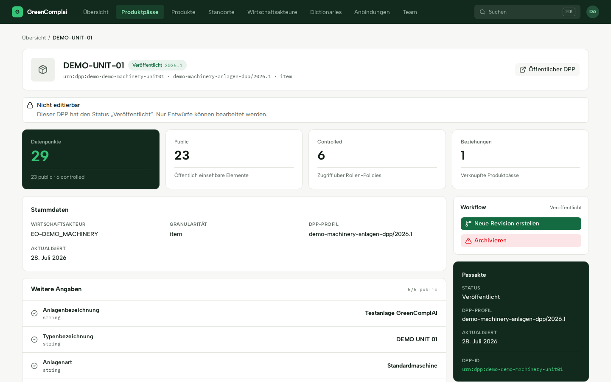

### Review and publish

Submit the draft for review, inspect it and publish it. The application prevents
a direct draft-to-published transition. It validates required fields, data types,
dictionary references and applicable policies before publication. Fix rejected
values in a draft and submit again.

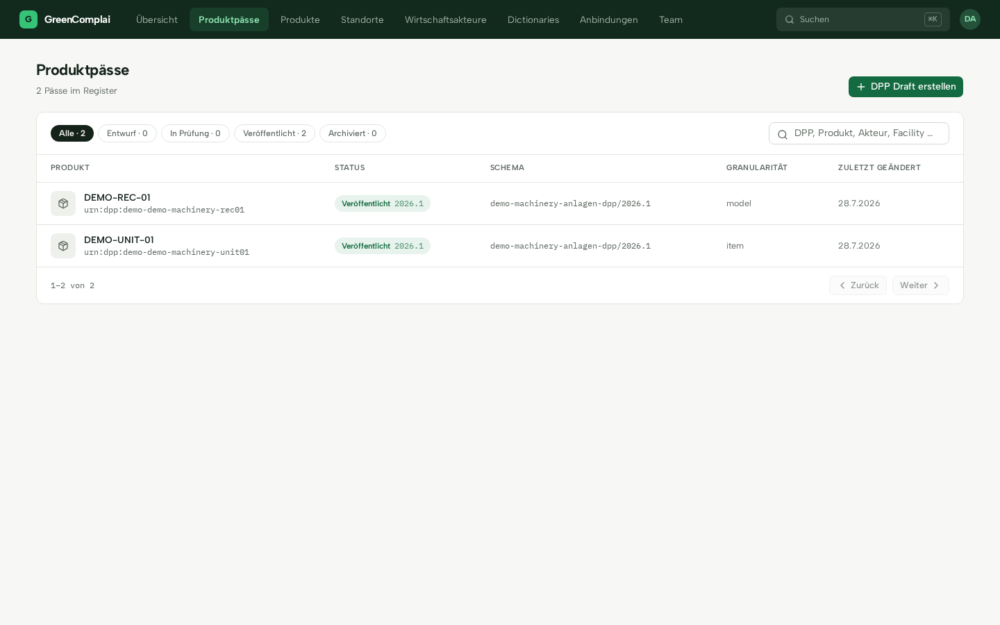

Use the public link on the passport page to inspect the anonymous view before
sharing it. QR codes and shared links should use `/dpp/<publicId>`, the stable
public identifier. The legacy `/p/<productId>` lookup can be ambiguous when
organizations use the same product identifier.

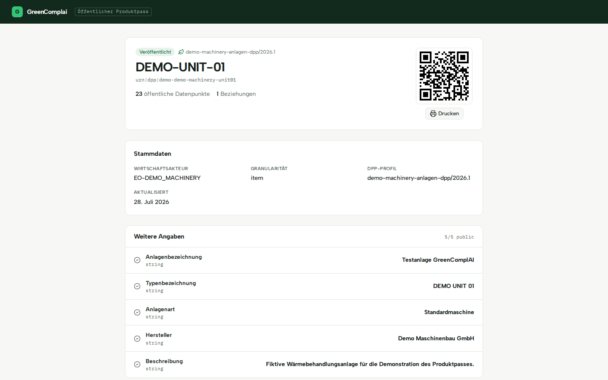

## Import from an external system

Administrators configure connector credentials; authorized editors can use
configured imports. The bundled SIMPL module reads assets and parts. It does
not write back to the source system through its supplied HTTP client.

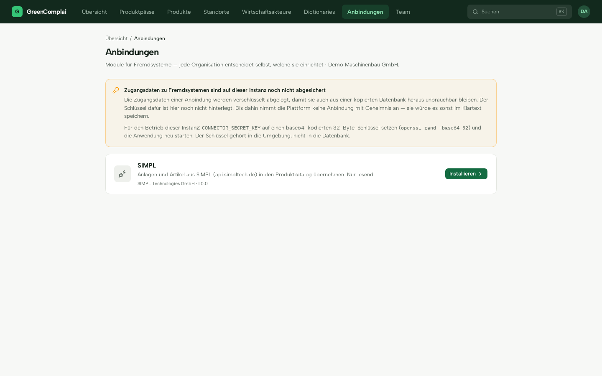

1. Install the module, enter credentials and test the connection. Check the
   displayed host. A test-server indicator means the development override is active.
2. Use the source field descriptions to draft a new dictionary or extend an
   editable one. Review proposed labels, types, units and categories.
3. Decide where additional source fields belong: a dictionary-backed passport
   element, source metadata, or ignored data. Mapping is reused for the same
   record type within the organization.
4. Look up the record by its identifier, inspect the preview, confirm the
   dictionary, responsible operator and granularity, then import it.
5. Review imported fields, visibility and missing required values before the
   normal review and publication workflow.

Document mappings determine which attachments are downloaded. Imported files
pass the same checks as browser uploads. An import reports skipped documents
rather than silently omitting them. See [Connectors](connectors.md) for details.

## Lifecycle and versions

A draft is editable and private. Review allows approval or returning to draft
with a reason. Publication exposes the public projection. Archival removes public
availability and is terminal for that passport.

To change a published passport, create a new revision. The existing published
version remains available while the next revision is drafted and reviewed.
History records version snapshots, field changes, status transitions and reasons.

Other passport functions include:

- Comparing earlier versions and viewing the published state at a date.
- Relationships such as contains, component of, replaces, variant, derived from,
  packaging and spare part.
- Documents, limited to 25 MiB by default. Download links expire; request a new
  link from the page when needed.
- Dictionary upgrade previews that show removed entries and changed constraints
  before applying an upgrade to an editable draft.

## Manage the team

Administrators invite members, assign roles and activate/deactivate memberships.
With SMTP configured, invitations are mailed. Otherwise share the displayed link
manually. Invitations expire. The last active administrator cannot be demoted
or deactivated.

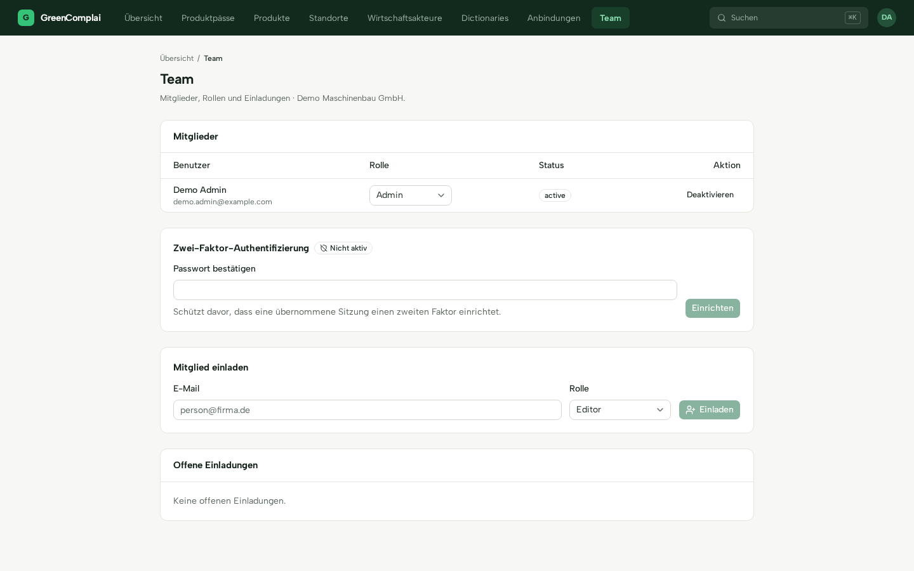

## Common questions

**Why can I not edit a field?** The passport may need a new draft revision, or
its policy may deny your role permission to write that field.

**Why was my change rejected after another person edited the passport?**
Reload the current state and apply your change again. Concurrent changes are
rejected instead of overwriting someone else's work.

**Why does publication fail?** Read the validation message. Common causes are
missing required fields, invalid types and missing dictionary references.

**Why does an upload fail?** Check the configured size/type limits. Renaming a
file does not bypass content inspection.

**Why has a download stopped working?** Signed links expire. Reload the page
or request the download again.

**Why can I not find a passport?** Check search and status filters, including
archived entries. Anonymous viewers can access only an available published version.
